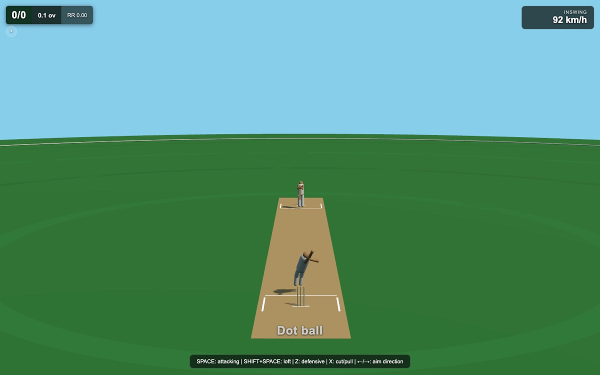

# KRIKET — early build



The first playable version of **KRIKET**, a browser cricket simulation built on
Three.js. Bat, bowl, field, and run with a physics-driven ball.

This is the earliest of three public versions. See also `kricket2` and `kriket3`
for the later physics/visual passes.

## Run

```bash
npm install
npm run dev
```

## License

Code: MIT (`LICENSE`). Original procedural assets: CC BY 4.0
(`ASSET-LICENSE.md`). Third-party components: `THIRD_PARTY.md`.
